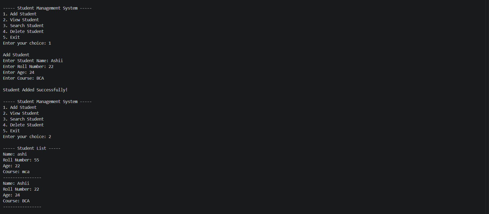

# Student Management System

A simple command-line Student Management System built using Python, with student data stored in a JSON file.
   
   ## Screenshot

   
   
## Features

- Add a new student
- View all students
- Search for a student
- Delete a student
- Save student data in JSON
- Basic error handling
- Duplicate roll number checking

## Technologies Used

- Python
- JSON

## How to Run

1. Make sure Python 3 is installed on your computer.
2. Download or clone this repository:
```bash
   git clone https://github.com/ashimalhotra1611/Student-Management-System.git
```
3. Open the project folder and run:
```bash
   python main.py
```

## What I Learned

- Working with JSON files in Python (reading and writing data)
- Using functions to organise code
- Handling errors and validating user input

## Author

Ashi Malhotra
[GitHub](https://github.com/ashimalhotra1611) · [LinkedIn](https://www.linkedin.com/in/ashi-malhotra-9989983b3/)
